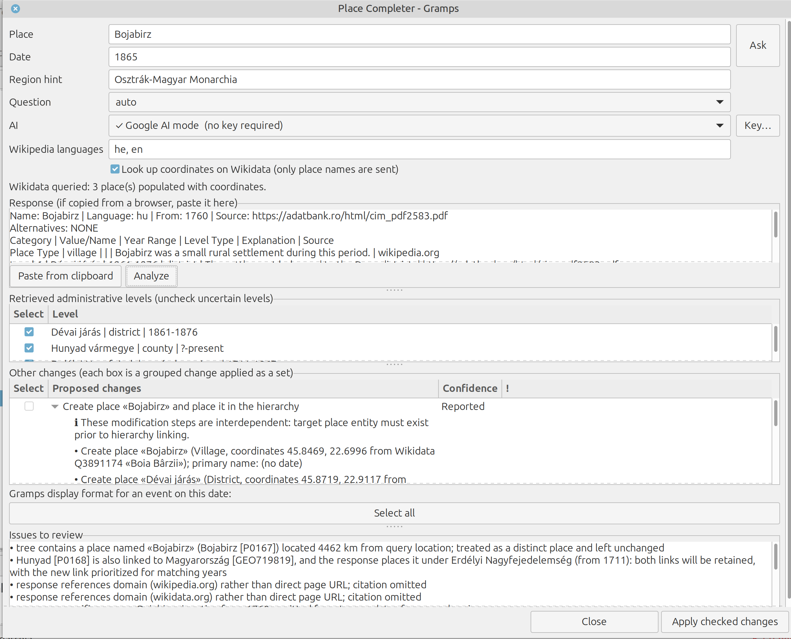

# Place Completer: A Gramps Addon

An addon for Gramps that attempts to complete the historical administrative hierarchy of a place for a specific date. Whether you are introducing a new place or validating and enriching an existing one in your tree, an AI generates the hierarchy, and the addon matches it against your database. It previews proposed modifications along with their rationale and writes only the changes you explicitly select—all in a single step that can be completely reverted via **Edit > Undo**.

> **Experimental & Provided As-Is:** This tool was developed for personal use. There is no formal support or guarantee of future updates (see [MAINTENANCE.md](MAINTENANCE.md)).  
> **Important:** Always back up your family tree before applying changes for the first time (*Family Trees > Make Backup*).

## Introduction

Gramps features one of the most sophisticated place handling systems among genealogy software—allowing researchers to model time-sensitive place names, types, and nested administrative hierarchies with remarkable accuracy. However, capturing these rich historical shifts manually demands substantial research and painstaking effort for every single location and event date. In practice, maintaining a hierarchy that accurately reflects reality on specific dates proves so complex that even dedicated users eventually tire of the exhaustive manual labor, often leaving their place data in a fragmented or chaotic state.

## The Need

Geographical places are inherently dynamic. Throughout history, a settlement might change its name, expand from a humble village into a thriving town, shift administrative or national allegiance, or even disappear entirely into a ghost town. 

Consider a person who was born and died at the exact same geographical coordinates in Central Europe, yet lived through continuous transformation: a birth registered in the Kingdom of Hungary (then part of Austria-Hungary; *Kolozsvár*), later Romania after the First World War (*Cluj*), briefly Hungarian again in 1940–1944 (*Kolozsvár*), and Romanian again afterwards (*Cluj*, renamed *Cluj-Napoca* in 1974). 

While Gramps features an exceptionally rich place model capable of recording these evolving names, types, and time-bounded administrative hierarchies, entering this historical reality manually for every life event is notoriously complex and tedious. A different approach was clearly needed—one that removes the friction from managing complex place hierarchies in Gramps, making historical accuracy intuitive and straightforward.

## What It Does

You provide a place name and a date (e.g., *Kolozsvár, 1899*). The addon formulates the query, transmits it to your chosen AI (or copies it to your clipboard for browser-based interaction), and parses the response. It extracts the place type, higher-level administrative containers with their active date ranges, the name the place had on that date (with its language), coordinates, and AI-cited sources. It then displays **proposed changes**, assigning each a confidence level (*Confirmed, Reported, Inferred, Unsure*) alongside its underlying rationale:

- Creates missing places and links them within the hierarchy **using precise date ranges** (ordered correctly, as Gramps evaluates date-matching links sequentially).
- Assigns place types, adds names (complete with languages and active periods) and web links, and populates missing coordinates (sourced from Wikidata upon request).
- Appends a **citation** for each modification, referencing the specific page identified by the AI.

**What it does not do:** It never modifies your data without explicit approval; it never alters existing tree data without flagging it (nothing is checked by default; conflicts are never chosen by *Select all*); and it does not automatically merge duplicate places (though it alerts you when two places share similarities). Ambiguous tree entries—such as *Johnston* in Iowa versus *Johnston* in Rhode Island—are automatically distinguished by coordinates when they are more than 30 km apart.



*The proposals window: each change comes with a confidence level and the reason for it. Nothing is written until you tick it and press Apply.*

## Supported AI Engines

| Engine | Prerequisites | Notes |
|---|---|---|
| **Claude API with web search** | API key | Supports source page citations. |
| **OpenAI-compatible endpoint** | API key and model name | Lacks native web search. |
| **Ollama** (Local) | Ollama installed | Free; the question never leaves your machine (installing it and downloading a model need the network); lacks web access and is generally less reliable. |
| **Google AI mode, ChatGPT, Gemini** (Browser-based) | None | The browser opens with the question entered (Google AI mode, ChatGPT) or the question is copied (Gemini); you paste the response back. |
| **Any other AI** | None | Same workflow, executed manually. |

An AI output is only as reliable as the underlying model. It may contain inaccuracies, hallucinate source pages, or exhibit varying performance across regions (testing was predominantly focused on European locations). Consequently, every modification is presented with its supporting evidence, and the addon rigorously cross-references the response against your existing family tree prior to proposing changes.

## Privacy: Data Leakage Disclosure

- **To your chosen AI:** The place name, date, optional region hint, and prompt text. **None** of your family tree data, individuals, or events are shared.
- **To Wikidata** (coordinate lookup, checked by default): Place names exclusively, used to fetch geographical coordinates via controlled, sequential requests.
- **Everything else remains local:** No telemetry, no user accounts, and no external servers.
- **API Keys:** Securely stored in your system keyring (through libsecret or the `secret-tool` command), or written to a restricted private file (permission mode 600) if no keyring is available. Only masked hints are ever displayed.
- **Answers cache:** Stored locally in `~/gramps-place-work/answers` (this directory can be customized via the `PLACECOMPLETER_WORK` environment variable).

## Installation (Linux)

**Requirements:** **Gramps 6.0 or 6.1** (tested on version 6.0.8, 6.1 beta 2, and contemporary master branches) along with the Python that runs Gramps. No external libraries are required. Optional dependencies include Ollama and `secret-tool`.

```bash
git clone https://github.com/avma/gramps-place-completer
cd gramps-place-completer
python3 deploy_addon.py --dry-run             # Simulates installation paths without writing files
python3 deploy_addon.py --translations        # Installs the addon (English version, including the Hebrew translation) into the user plugins directory for this Python environment
```

The plugins folder is **version-specific** (`gramps60`, `gramps61`): ensure you run the script using the Python interpreter tied to your Gramps installation, or explicitly target a directory using `--dir`.  
Passing `--clean` archives older copies to `~/gramps-place-work/backups` without deleting anything. Restart Gramps, then navigate to:  
**Tools > Family Tree Processing > Place Completer**. Dedicated Gramplets for places and events, as well as a Place Quick View, are also provided.  
To uninstall, simply delete the `PlaceCompleter` folder from your plugins directory.

## Platforms

Tested only on Linux Mint (version 22.3 at the time of writing). It has not been tested on Windows or macOS, and the installation instructions target Linux. While the core engine is plain Python, the following components rely on Linux-specific behaviors and are the most likely to differ on other operating systems:

| Feature | Linux (Addon behavior) | Elsewhere |
|---|---|---|
| **Plugin directory location** | `~/.local/share/gramps/gramps60/plugins` (queried from Gramps via `deploy_addon.py`) | Untested |
| **Clipboard integration** (copying prompt, pasting response) | `xclip`, `xsel`, or `wl-copy`/`wl-paste` | Untested / Not supported |
| **API key storage** | System keyring via `secret-tool`, or restricted file (mode 600) | File permissions differ on Windows/macOS |
| **Ollama installation & service control** | Ollama install script, `systemctl`, and terminal launchers (`gnome-terminal`, `konsole`, `xfce4-terminal`, `mate-terminal`, `x-terminal-emulator`) | Untested / Not supported |

If you test this addon on Windows or macOS, feedback is welcome, though fixes for non-Linux platforms cannot be guaranteed.

## Your own place types

If your tree uses custom place types for administrative units (a canton, a district, in any language), copy `data/type-conventions.json` to `~/.config/placecompleter/type-conventions.json`
and fill it in (see `data/type-conventions.example-he.json`); an update of the addon does not touch that copy. Without it, the types of Gramps itself are used.

## Languages

Available in English with a complete **Hebrew** translation (`po/he-local.po`). Place type designations match those natively used by Gramps. Template files for localization can be found at `po/template.pot`, and `tools/po_exchange.py` facilitates compatibility with Poedit.

## Compatibility

The addon explicitly declares the Gramps versions it has been validated against, and **Gramps will refuse to load it on unsupported versions** to prevent unintended data corruption. It is structured around the current Gramps place architecture (single primary name, alternative names, single type). The proposed place model redesign ([GEPS 045](https://gramps-project.org/wiki/index.php/GEPS_045:_Place_Model_Enhancements), currently stalled) would require adjustments if it is ever adopted; a safeguard test (`tests/test_00_place_model.py`) is included to catch architectural mismatches early.

## Testing

```bash
python3 -m unittest discover -s tests         # Runs ~1,300 offline tests (no network required)
sh tools/setup_gramps_versions.sh             # One-time setup: configures multiple Gramps versions locally
sh tools/check_all.sh                         # Executes test suites across all configured versions
```

While several tests construct a live Gramps database, window components are validated against a GTK mock implementation—therefore, **visual inspection within Gramps is recommended** before production use.

## Documentation

[docs/DEVELOPER_GUIDE.md](docs/DEVELOPER_GUIDE.md) (architecture and tools) · [docs/MODULES.md](docs/MODULES.md) · [docs/ANALYZER_RULES.md](docs/ANALYZER_RULES.md) (analysis rules and safety boundaries) · [docs/RULES_REVIEW.md](docs/RULES_REVIEW.md) (which rules fire on 20 real-world responses, and which never do) · [docs/CODE_REVIEW.md](docs/CODE_REVIEW.md) · [MAINTENANCE.md](MAINTENANCE.md) · [docs/GLOSSARY_HE.md](docs/GLOSSARY_HE.md) (Hebrew terminology)

## Related Addons

**Place Cleanup** (specialized in merging and GeoNames-based completion) and **PlaceCompletion** (manual field completion lists) serve alternative workflows. This addon is uniquely centered around queries anchored to a place *on a specific date*, outputting dated links, types, and names.

## How it was made

Developed with the assistance of an AI assistant (Claude by Anthropic), which authored the majority of the code and test suites under direct architectural guidance, curation, and testing.

## License

GNU General Public License, version 2 or (at your option) any later version: see [LICENSE](LICENSE). Copyright (C) 2026 Avi Markovitz.