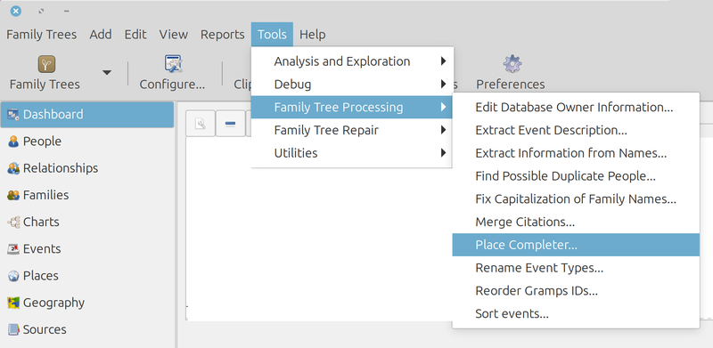
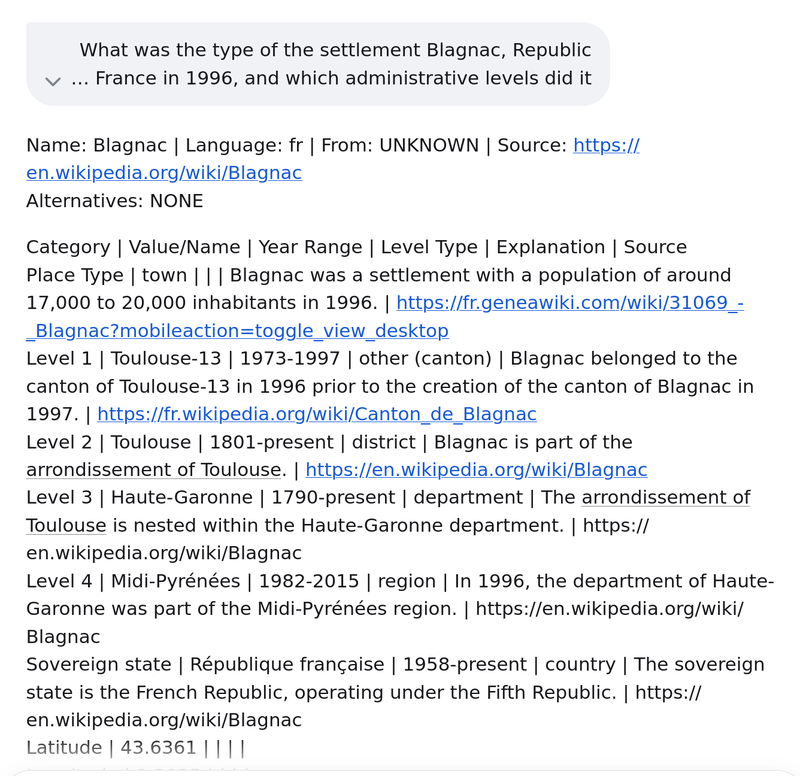
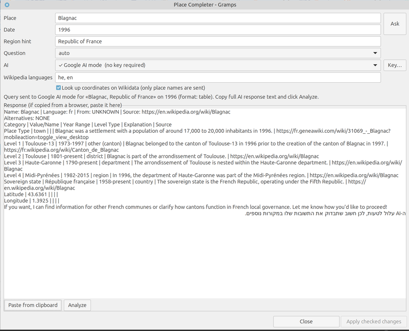
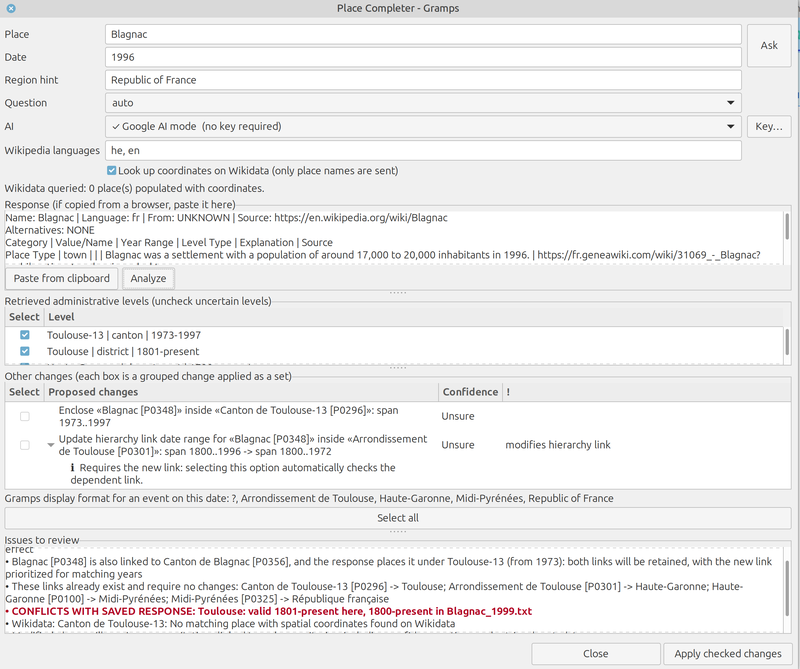
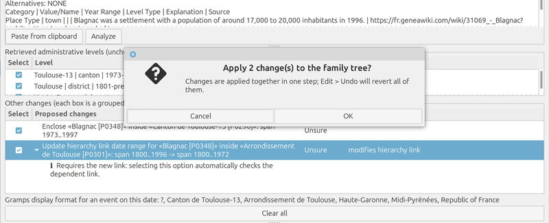
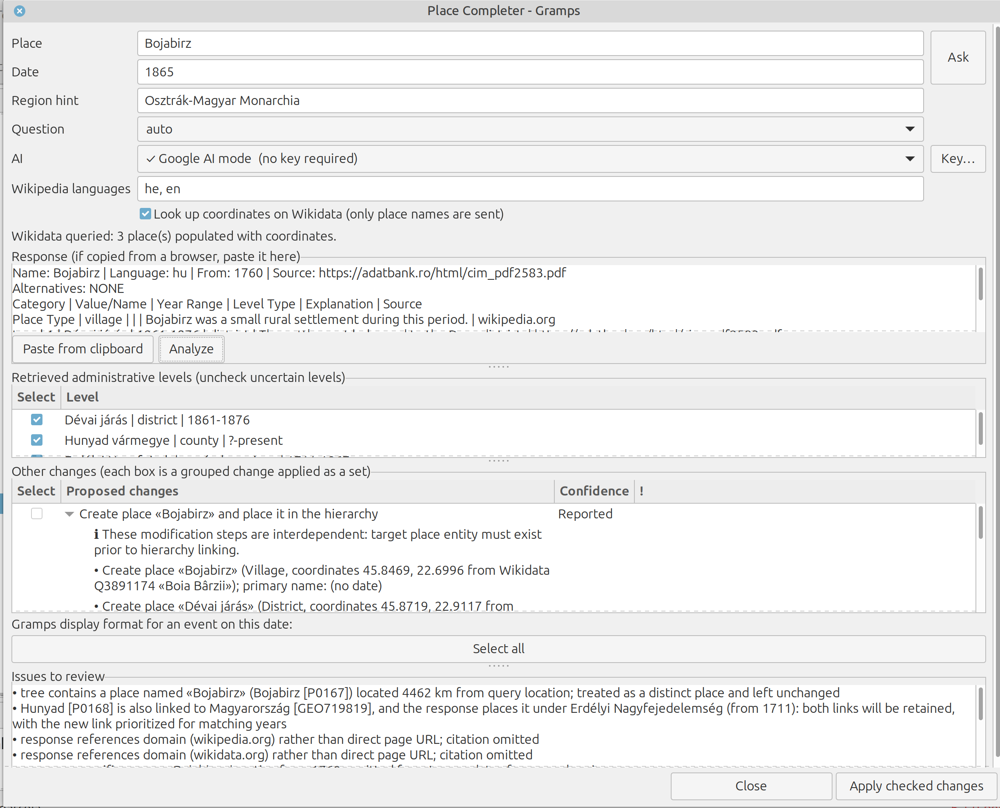
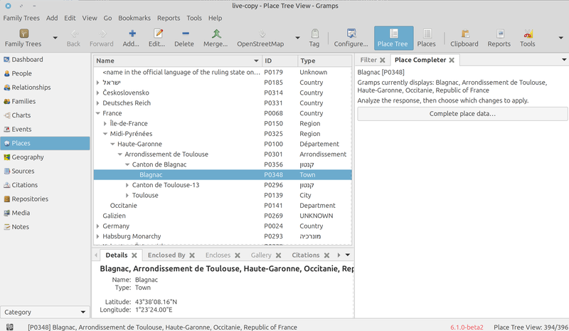

# Place Completer: User Guide

This guide accompanies the [README](../README.md). While the README gives a high-level overview of the addon, this guide explains how to use it, step by step. All field names, buttons and menu options are the ones that the application shows (in English; the Hebrew interface has the matching terms).

**Contents:** [Quick Start](#quick-start) · [The Main Window](#the-main-window) · [Interpreting Proposals](#interpreting-proposals) · [Applying and Undoing Changes](#applying-and-undoing-changes) · [What Is Written to the Database](#what-is-written-to-the-database) · [Selecting an AI Engine](#selecting-an-ai-engine) · [API Key Management](#api-key-management) · [Gramplets and Quick View](#gramplets-and-quick-view) · [Configuration and Files](#configuration-and-files) · [Custom Place Types](#custom-place-types) · [Privacy and Data Security](#privacy-and-data-security) · [Troubleshooting](#troubleshooting) · [Uninstallation](#uninstallation)

---

## Quick Start

It is recommended to try the addon first on a **copy of your family tree**, or after creating a full backup (*Family Trees > Make Backup*). A browser-based AI engine needs no API key.

**Where to start.** The window can be opened in three ways:

- **From the Events view (the most convenient).** With the *Place Completer* gramplet on the Events view, select an event and click **Complete place data…**: the window opens with the **place and the date of the event** already filled in.
- **From the Places view.** With the *Place Completer (places)* gramplet, or the Quick View (right-click a place), the window opens with the **name of the active place**; you enter the date.
- **From the menu:** *Tools > Family Tree Processing > Place Completer*; you enter both.

The date to enter is usually the date of the event whose place details you want to complete: a birth in 1899 needs the place as it was in 1899. (Adding a gramplet is described in [Gramplets and Quick View](#gramplets-and-quick-view).)

1. **Open the window** in one of the ways above.

   

   *Opening the tool from the menu: Tools > Family Tree Processing > Place Completer…*
2. **Check the place and the date.** Enter the place as you normally write it (for example *Blagnac*) and the date of interest (*1999*, *1999-05* or *1999-05-17*).
3. **Choose an AI engine** (*Google AI mode*, *ChatGPT* or *Gemini*) and click **Ask**. Your browser opens with the question already entered (for *Gemini* the question is copied to the clipboard: paste it with `Ctrl+V`).
4. **Bring the response back.** Copy the whole response of the AI, click **Paste from clipboard** (or paste it into the *Response* box) and click **Analyze**.

   

   *The response of the AI in the browser: copy all of it.*

   

   *The window after **Paste from clipboard**: the response is in the box, ready to **Analyze**.*
5. **Review the proposals.** When the analysis finishes, **no change is checked** (the retrieved levels are checked: uncheck a level that you doubt). Check the changes you accept, or click **Select all** and uncheck what you doubt.

   

   *The proposals: each change has a check box, a confidence level and, when it needs care, a flag; *Issues to review* are listed below (a red line is a warning).*
6. **Apply.** Click **Apply checked changes** and confirm. **Edit > Undo** takes the changes back (see [Applying and Undoing Changes](#applying-and-undoing-changes)).

   

   *The confirmation: all checked changes are applied together in one step.*

Three optional settings are described in [The Main Window](#the-main-window): the form of the question (**Question**, left on `auto`), the **Wikipedia languages**, and the checkbox **Look up coordinates on Wikidata** (checked by default).

---

## The Main Window

*The main window after **Analyze** (the example is Bojabirz in 1865): the fields at the top, the response, the retrieved levels, the changes (the grouped change is applied as a set) and the issues to review.*

| Field / Control | Description |
|---|---|
| **Place** | The place to look up, as you would write it: *Parma*, *Sissa*, *Johnston*. |
| **Date** | The year for which you want the names and the administrative levels: `1850`; a month or a day is allowed (`1990-05`, `1990-05-17`). |
| **Region hint** | *Optional.* A word that tells this place from others of the same name: a county, a state or a country (*Parma* with *Italy*, *Johnston* with *Iowa*). If you give a country, the question also lists the administrative levels that the country had in that year. |
| **Question** | The form of the question that is sent. Leave it on `auto`: it tries `table` first, then `classic`, `short`, `dated` and `long`, until the AI gives a response that can be read (at most five questions). `table` asks for a short response in a table that is easy to check; `classic` is the full question with an explanation of every field; `short` has the same fields in one paragraph, for services that refuse a long question; `dated` adds that the name, the type and the containers must be those of the date, not of today; `long` is the longest and asks whether the name, the type or the containers differ from today's. |
| **AI** | Which AI answers. A check mark means that it is ready; a cross says what is missing (usually a key). See [Selecting an AI Engine](#selecting-an-ai-engine). |
| **Ask** | Sends the question to the chosen AI. An AI with a key answers by itself and its response appears in the *Response* box; a browser engine opens the browser. **Nothing in the tree changes at this stage.** |
| **Key…** | Opens the window where you enter the API key of the chosen AI, once. See [API Key Management](#api-key-management). |
| **Wikipedia languages** | The languages of the Wikipedia articles that are attached to the places as web links, in the order of your preference (`he, en`). See [Wikipedia languages in detail](#wikipedia-languages-in-detail) below. |
| **Look up coordinates on Wikidata** | A checkbox, **checked by default**. After the analysis the addon looks up, in Wikidata, the coordinates of places that have none (and, for the main place, the Wikipedia articles in your languages). Only the names of the places are sent. Uncheck it to send nothing to Wikidata. |
| **Response** | The response of the AI. When the AI answered by itself it appears here; when you used a browser, paste the whole response here. |
| **Paste from clipboard** | Puts the text of the clipboard in the *Response* box. |
| **Analyze** | Reads the response and shows what it would change in the tree. **Nothing changes yet.** |
| **Retrieved administrative levels** | The levels that the response lists, from the smallest. **They start checked:** uncheck a level that you doubt, and it is left out of the changes. |
| **Proposed changes** | The changes, each with a check box, its *Confidence* and what it does. |
| **Other changes** | Changes made of several steps, applied as a set: each box is one change, and its steps are applied together or not at all. |
| **Select all** / **Clear all** | One button that toggles: it checks every change that can be checked without a decision from you, or clears all. |
| **Issues to review** | The notes and warnings of the analysis (warnings are red). Read them before you apply. |
| **Apply checked changes** | Writes the changes that you checked, in one step. |
| **Help** | Opens this guide in your web browser (the window stays open). The *Help* of the gramplets opens it too. |

The line *Gramps display format for an event on this date* shows how Gramps would display the place on that date, and it changes as you check and uncheck.

### Wikipedia languages in detail

The field is a list of Wikipedia language codes in the order of your preference, separated by commas: `he, en` or `fr, es`. It decides **which Wikipedia articles are added to a place as web links**. It does **not** change the language in which the AI responds (the question is always in English).

- **One article per language.** A place receives at most one Wikipedia article for each language in your list, one Wikidata link, and at most two other sites (those whose address looks official). The links that the place already has count toward these limits, and the same page in another form (`http` or `https`, `www`, mobile, a fragment) is the same link.
- **Where the articles come from.** From the pages that the AI cites (in any language) and, for the **main place** (the one you asked about), from its Wikidata item when *Look up coordinates on Wikidata* is checked: Wikidata lists the articles that exist in each language, so the addon can offer the article in your language even when the AI cited only the English one. An address is never guessed.
- **English is the fallback**: it is used only when none of your languages has an article.
- **The default** is the language of Gramps and then English (only English when Gramps is in English). Only language codes are accepted (`he`, `en`, `fr` …). The list is kept in `~/.config/placecompleter/settings.json`.

---

## Interpreting Proposals

Each proposal says what it does, in plain words:

| Display text | Meaning |
|---|---|
| *Create place «X» (Town); primary name: from [date]* | A place that is not in the tree, with its type and the period of its name. The type is chosen as described in [Place types](#place-types). |
| *Enclose X inside Y: from [date]* | Links X into Y **with a date range**. |
| *Insert X between Y and Z* | A level that is missing between two places that are linked directly. |
| *Move X from Y to Z*, *Prioritize link of X inside Y over link inside Z* | The order of the links matters: **Gramps uses the first link in the list that fits the date.** |
| *Disconnect X from Y* | Removes a link (both places stay). |
| *Update hierarchy link date range…* | A link that exists gets another period. |
| *Change administrative place type of X from A to B*, *Set administrative place type of X to B* | The type of the place. |
| *Set missing coordinates for X…* | Empty coordinates, from the response or from Wikidata. |
| *Assign date period to name…*, *Set language tag for name…*, *Add place name…* | Names, with their periods and languages. |
| *Attach web link… to X* | A link to a page that the AI cited, or a Wikipedia or Wikidata link. |

### Confidence

Each change has a level; a change made of several steps has the level of its least sure step.

- **Confirmed**: independent data agrees (Wikidata, a regional pack, or the tree itself).
- **Reported**: the response states it and cites a page that supports it.
- **Inferred**: worked out by the program from other data; check it.
- **Unsure**: the response says it is not sure, contradicts itself, or cites no page.

### Flags

A small label on a change tells what kind of care it needs: *modifies existing tree data*, *disconnects place link*, *modifies hierarchy link*, *inserts intermediate level*, *renames place*, *modifies place type*, *verify official status of web source* (a site of an unknown kind: is it official?), and *populates unassigned field* (fills something that was empty).

### What is checked, and what Select all does

**When the proposals appear, no change is checked** (the retrieved levels are, because what you do with them is to uncheck what you doubt). A change to data that already exists is marked as such. **Select all** checks everything that can be chosen without a decision from you, **including changes to existing data that are not in conflict** (read their flags first), and it leaves out, for you to decide one by one: a **CONFLICT** with the tree (for example a link that the response says is wrong), a web link of an unknown kind, and changes that cannot be made together (check one or the other). Read *Issues to review* before you apply.

### Place types

The type of a place is chosen from the types of Gramps itself:

- **A settlement** (the question asks for its size class): *metropolis* and *city* become **City**, *town* **Town**, *village* **Village**, *hamlet* **Hamlet**, plus *neighborhood* and *locality*. The legal status (commune, municipality …) is not part of the answer.
- **An administrative level** (country, state, province, county, district …) gets the type of Gramps that fits the word the AI used. If Gramps has no such type (a *canton*, for example), the **word of the response is used as a custom type** (`Canton`).
- **A place that already exists keeps its type.** It is changed only when the tree has a settlement type of Gramps (City, Town, Village …) and the response gives a different size class: the change is then proposed, flagged *modifies place type*, for you to decide. When the type of the place is not a settlement (a District, a Province, a type of your own) the type is not changed, and *Issues to review* says so: the place may be the canton or the province of the same name, or the town itself typed wrongly. A place with **no type** is given the type of the response.
- **Types of your own** (custom types, in the language of your tree) are used only where you describe them in the file `type-conventions.json`: see [Custom Place Types](#custom-place-types). The file is written by you; **the addon does not yet learn the types of your tree by itself** (this is planned: it would read the custom types that the tree already uses).

---

## Applying and Undoing Changes

Clicking **Apply checked changes** asks for a final confirmation and writes all checked changes in **one single step**; a message tells how many were applied.

**Undo is a built-in feature of Gramps**: *Edit > Undo* restores the tree to the state before the changes, all of them together. Gramps keeps the undo history only while the tree is open, so check the result before you close the tree; a backup is the safe way back.

Each place that changed also receives **citations** for the pages that the AI cited (see [What Is Written to the Database](#what-is-written-to-the-database)). The response is also kept in a file (see [Configuration and Files](#configuration-and-files)). If you ask for the same place on another date and the response is identical to the one saved for the first date, the addon warns you: the AI probably returned a fixed text for different dates.

---

## What Is Written to the Database

Only the places that you check are touched, and nothing else in the tree.

| What | How it is written |
|---|---|
| **New places** | A place with its name (and the language of the name), its type, its place in the hierarchy and, when known, coordinates and web links. |
| **Names** | The primary name of a place keeps its language and the period when the name was used. When the name changes, the old name stays as an **alternative name**, with its language and its period. |
| **Type** | Set for a new place or one with no type; changed only as described in [Place types](#place-types). |
| **Hierarchy (enclosure) links** | A link to the place that encloses it, **with a date range**, placed so that the first link that fits a date is the right one. *Disconnect* removes a link, never a place. |
| **Coordinates** | Latitude and longitude, only where they are empty (from the response or from Wikidata). |
| **Web links** | In the *Internet* tab of the place: the Wikipedia articles of your languages, a Wikidata link, and at most two other sites (see [Wikipedia languages in detail](#wikipedia-languages-in-detail)). |
| **Citations** | The chain **Place → Citation → Source → Repository**, below. |

**The chain of a citation.**

- **Repository**: the web site that the page belongs to (Wikipedia, Wikidata …). The repository that the tree already has is used; a new one is made only when there is none.
- **Source**: one for each web page. Its title is the title of the page, and the address is kept in the publication information and as a source attribute named `URL`, which is how the addon finds it again. A source that the tree already has (the same page in another form) is used again, not duplicated.
- **Citation**: its *page* text says **what the page is cited for**; its date is the **day the information was retrieved**; its confidence is *Normal*, *Low* or *Very Low* (for a Wikidata statement, *Normal*; for an AI response it follows how sure the response was, and one level lower when the analysis found that the response contradicts itself or an answer saved for another date; a tourism, commercial or social site is never above *Low*).
- **Note** (of the type *Place*, attached to the **citation**, not to the place): **how the information was found**: which AI and model, on what day, in response to which question and form, where the response is saved, and what the response was unsure about.

A place receives **at most three new citations in one run** (the strongest first: higher confidence, then Wikidata, Wikipedia, official sites, other sites), and a citation that already exists is not added again. A citation goes to the place that its page is **about**; a page about none of the places is cited on the main place. What the limit left out is reported after the changes are applied.

**What is never written:** events, people, merges of places, or the deletion of a place.

---

## Selecting an AI Engine

All engines appear in the **AI** list; a check mark means that the engine is ready.

| Engine | Requirements | Notes |
|---|---|---|
| **Claude API with web search** | An Anthropic API key | Responds by itself, and can cite pages. |
| **OpenAI-compatible** | An API key and a model | Responds by itself; no web search of its own. |
| **Ollama** | Ollama on your computer | Free; the question never leaves your computer; no web access, so less reliable. Installing Ollama and downloading a model need the network. |
| **Google AI mode**, **ChatGPT** | Nothing | The browser opens with the question already in its address; you paste the response back. |
| **Gemini**, **any other AI** | Nothing | The question is copied: paste it (`Ctrl+V`) in the AI, then copy the response back. |

**Claude API.** Click **Key…**, paste the key, **Save**; **Test** says whether the service accepts it. The model is chosen by the addon.

**OpenAI-compatible.** Save the key in the same way. The addon asks the service for its models and chooses one. If it cannot choose, write the model in `~/.config/placecompleter/engines.json`:

    {"engines": {"openai": {"model": "the-name-of-the-model"}}}

Another service that speaks the same language (a local one, for example) is added in the same way, with its `base_url`.

**Ollama.** Select *Ollama* and click **Ask**. If Ollama is not installed, the window offers to open a terminal with the installer (it asks for your administrator password **in the terminal**, not in the window). If it is installed but not running, it offers to start it (it then runs in the background). If it has no model, **Download a model** offers a small one (about 2 GB, recommended) or any name from ollama.com/library. The download can be cancelled.

**A browser engine** can be added in `engines.json` for any AI that takes a question in its address (the question goes where `{q}` is):

    {"engines": {"perplexity": {"kind": "browser", "label": "Perplexity", "url": "https://www.perplexity.ai/search?q={q}"}}}

---

## API Key Management

*Optional.* A key is needed only for the engines that respond by themselves and are paid by use (**Claude API**, **OpenAI-compatible**): the provider of the service charges according to its own price list. The browser engines and Ollama need no key. Every **Ask** sends one question; with `auto`, a response that cannot be read may be followed by up to five questions in all.

An API key is kept, in this order of preference: in the **keyring of your system** (through libsecret, or the `secret-tool` command), else in a **private file** under `~/.config/placecompleter/keys/` (mode 600: readable by you alone). It is never put on a command line, in a log, in the Gramps database or in the settings of the window, and the window shows only a masked hint (`sk-ant-…wXyZ`, and the number of characters). **Remove** (in the key window) deletes it.

For scripts, an environment variable named in `engines.json` (`ANTHROPIC_API_KEY`, `OPENAI_API_KEY`) wins over everything. `PLACECOMPLETER_KEYSTORE=none` keeps no key at all; `file` or `keyring` forces one of the two places.

---

## Gramplets and Quick View

The addon has three places to start from (besides the menu):

- **Place Completer**, a gramplet of the *Events* view: shows the type and the date of the active event, and **how Gramps displays its place on that date**. When the place has names but none for that date, it says so: *Names are missing for this date (place displayed with «?»)*. **Complete place data…** opens the window with the place and the date of the event.
- **Place Completer (places)**, a gramplet of the *Places* view (its title in the sidebar is *Place Completer*): shows the active place, how Gramps displays it, and **what it lacks** (coordinates, type, language of the name, a cited source). **Complete place data…** opens the window with the name of the place; give the date and click **Ask**.
- **Quick View**, from the context menu of a place (right-click): the same as the gramplet of places.

*The gramplet in the sidebar of the Places view: how Gramps displays the active place, and the button that opens the window.*

To add a gramplet, which is a **standard feature of Gramps**: right-click the bar of the sidebar or of the bottom bar of the view and choose *Add a gramplet*.

---

## Configuration and Files

| What | Where |
|---|---|
| The addon | The plugins folder of your Gramps (`~/.local/share/gramps/gramps60/plugins/PlaceCompleter`; `gramps61` for 6.1) |
| The responses that were received | `~/gramps-place-work/answers/<place>_<date>.txt` |
| What the window remembers (the AI, the form, the Wikidata box) | `~/gramps-place-work/window.json` |
| The log of `ollama serve`, when the addon started it | `~/gramps-place-work/ollama-serve.log` |
| Older copies of the addon (`deploy_addon.py --clean`) | `~/gramps-place-work/backups/` |
| Your engines | `~/.config/placecompleter/engines.json` |
| The model that the addon chose by itself (no secret in it) | `~/.config/placecompleter/models.json` |
| Your Wikipedia languages | `~/.config/placecompleter/settings.json` |
| Your keys, when there is no keyring | `~/.config/placecompleter/keys/` |
| The types of your tree | `~/.config/placecompleter/type-conventions.json` |

| Environment variable | What it does |
|---|---|
| `PLACECOMPLETER_WORK` | The folder of the responses, of what the window remembers and of the backups (default `~/gramps-place-work`) |
| `PLACECOMPLETER_KEYSTORE` | `none`, `file` or `keyring`: where keys are kept |
| `PLACECOMPLETER_ENGINES`, `PLACECOMPLETER_MODELS`, `PLACECOMPLETER_SETTINGS` | Another file in place of `engines.json`, `models.json`, `settings.json` |
| `PLACECOMPLETER_CONVENTIONS` | Another file in place of `type-conventions.json` |
| `PLACECOMPLETER_TREE`, `PLACECOMPLETER_CACHE`, `PLACECOMPLETER_LIVE_DIRS` | For the command line (`placecompleter/cli.py`): the tree to read, the file of what Wikidata answered, the folders that hold live data and are refused |
| `PLACECOMPLETER_RULES_OFF`, `PLACECOMPLETER_RULES_ON` | Switch rules of the analysis off or on, by their ids (`docs/ANALYZER_RULES.md`). For the curious; the defaults are the tested ones |

---

## Custom Place Types

If your tree uses custom place types for administrative units (a canton, a district, in any language), copy `data/type-conventions.json` to `~/.config/placecompleter/type-conventions.json` and describe your types in it (see `data/type-conventions.example-he.json`, the types of a tree in Hebrew). The file says which of your types is a province, an empire, a district or a settlement, and gives rules of the form *when the response calls a level by one of these words, give it this type*. An update of the addon does not touch that copy. Without it, the types of Gramps itself are used, and a unit that Gramps has no type for (a canton, for example) is given the word of the response as a custom type.

**The file is written by you.** Learning the custom types from the tree itself (Gramps keeps the list of the custom types that a tree uses) is planned and does not exist yet.

---

## Privacy and Data Security

- **Sent to the AI you choose:** the name of the place, the date, the optional region hint and the text of the question. **Your tree, your people and your events are never sent.** With *Google AI mode* and *ChatGPT* the question is in the address that the browser opens.
- **Sent to Wikidata**, when *Look up coordinates on Wikidata* is checked: the names of the places that need coordinates, one request at a time.
- **Nothing else** leaves your computer: no telemetry, no tracking, no remote analytics, no server of the author.

---

## Troubleshooting

| What you see | What it means, and what to do |
|---|---|
| *No API key saved for this AI engine yet* | Click **Key…** |
| *…rejected API key authentication (HTTP 401)* | The service does not accept the key: check in the dashboard of the provider that it is active and has credit, and enter it again. |
| *…does not recognize the model «X»* | Choose another model in `engines.json` (see [Selecting an AI Engine](#selecting-an-ai-engine)). |
| *key file … has insecure permissions* | `chmod 600` on that file. |
| *Ollama is not active locally* | Click **Ask** for the guided steps, or run `ollama serve`. |
| *Ollama is running but no model is installed* | **Download a model**. |
| *Could not launch web browser. Please open this URL manually* | Copy the address that follows and open it yourself. |
| *Text does not conform to the expected response template* | The response is not in the form that was asked: paste the **whole** response, or try another AI or another *Question* form. |
| *AI returned unfulfilled prompt* | The AI gave the question back: add a *Region hint* (a county, for example) or use another AI. |
| *This name matches multiple places. Which one did you mean?* | The tree has several places of this name: choose one (nothing is created until you do). |
| *Names are missing for this date (place displayed with «?»)* | The place has names, but none valid for that date: the addon proposes the missing name. |
| *…has leading/trailing whitespace*, *enclosed in quotation marks* | The addon removes spaces and line breaks at the ends of a key, and quotation marks around it, by itself. |
| *…contains internal spaces or line breaks* | Spaces or line breaks **inside** the key mean that the copy is damaged: copy it again. |
| The Hebrew text looks reversed around a command or an address | Please report it: those are wrapped in marks of direction, and a case that slipped is a bug. |
| Nothing is proposed | Read *Issues to review*: usually the response has no name for the place. |

If a question to an AI fails five times, the window says so: try again later, add a region word, or choose another engine.

---

## Uninstallation

Delete the folder `PlaceCompleter` from the plugins folder of your Gramps and restart. To remove everything it left, first click **Remove** in the key window of each AI (so that the key leaves the keyring), then delete `~/.config/placecompleter` and `~/gramps-place-work`. Nothing was ever written to your tree except the changes that you applied.
